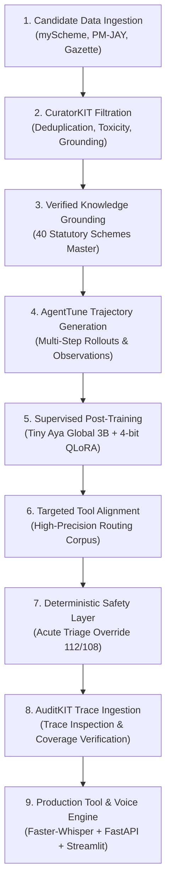

# SanoVocal: Safe Agentic Healthcare & Welfare Navigation for Multilingual India 🩺🇮🇳

[](https://lexsi.ai)
[](https://creativecommons.org/licenses/by/4.0/)
[-blue.svg)](https://huggingface.co/CohereLabs/tiny-aya-global)
[](#-verification--testing)
[](#-before--after-benchmarks)

**SanoVocal** is an end-to-end, safety-grounded agentic voice assistant engineered to help Indian citizens navigate complex government health and social welfare entitlements across English, Hindi, and Hinglish. 

Developed for the **Lexsi AI Safety & Alignment Hackathon (Track 3: Agentic Fine-Tuning)**, SanoVocal addresses the central risks of deploying conversational agents in public administration: eliminating hallucinated eligibility promises, enforcing non-negotiable clinical emergency triage, preventing unauthorized tool calls, and grounding all guidance in statutory evidence.

---

## 📌 Submission Resources & Links

- **GitHub Repository**: `https://github.com/rohith871/SanoVocal`
- **Hugging Face Model**: `https://huggingface.co/rohith871/sanovocal-adapter`
- **Hugging Face Dataset**: `https://huggingface.co/datasets/rohith871/sanovocal-datasets`
- **Hugging Face Model Collection**: `https://huggingface.co/collections/rohith871/sanovocal-models`
- **Hugging Face Dataset Collection**: `https://huggingface.co/collections/rohith871/sanovocal-datasets`
- **Public Demo**: Not yet deployed (Local Streamlit interface operational at `http://localhost:8501`)
- **Submission Artifacts**:
  - [Executive Abstract](submission/ABSTRACT.md)
  - [Model Card](submission/MODEL_CARD.md)
  - [Dataset Card](submission/DATASET_CARD.md)
  - [Evaluation Summary](submission/EVALUATION_SUMMARY.md)
  - [Submission Checklist](submission/SUBMISSION_CHECKLIST.md)

---

## 📄 Abstract (< 500 Words)

Navigating public healthcare entitlements in India is fraught with administrative opacity, linguistic exclusion, and bureaucratic fragmentation. Millions of eligible citizens fail to access statutory programs like Ayushman Bharat (PM-JAY) or maternity benefits (PMMVY) due to complex documentation rules, lack of digital literacy, and language barriers. While Large Language Models offer promise as conversational navigators, generic foundation models deployed in civic healthcare present catastrophic failure modes: hallucinating eligibility criteria, fabricating non-existent schemes, prescribing medication without clinical qualification, and failing to route acute medical emergencies to emergency services.

We present **SanoVocal**, an agentic post-trained, voice-first civic healthcare assistant built upon Cohere’s multilingual **Tiny Aya Global (3B)**. SanoVocal transforms civic healthcare navigation into a reliable, safety-aligned agentic workflow across English, Hindi, and Hinglish. Our methodology integrates a 9-stage engineering pipeline: (1) candidate data curation, (2) quality filtration via CuratorKIT, (3) statutory knowledge grounding against 40 verified central and state welfare programs, (4) synthetic trajectory generation via AgentTune, (5) 4-bit NF4 QLoRA supervised post-training, (6) targeted tool contract alignment, (7) deterministic clinical safety guardrails, (8) trace inspection via AuditKIT, and (9) production tool orchestration powering a real-time speech interface.

SanoVocal enforces a strict, closed contract of **seven official tools** (`emergency_screen`, `match_schemes`, `get_scheme_rules`, `get_documents`, `find_facility`, `create_case_summary`, `escalate_to_human`). Hallucinated tool calls and illegal schemas are deterministically intercepted and blocked. Crucially, a deterministic safety triage layer scans citizen utterances for acute red-flag symptoms (e.g., myocardial infarction, respiratory distress, trauma), executing immediate overrides directing citizens to national emergency services (112/108) within ~2.1 seconds, completely bypassing standard welfare dialogue.

We evaluated SanoVocal against the unadapted base model on a held-out, cryptographically locked 45-scenario test set (SHA256: `667E60B9F0EDABB2DE7232DA50A2F92E6362662A37B80701FB26BB7205366FC3`). SanoVocal increased Tool Invocation Coverage from 44.44% to **63.89% (+19.45%)**, improved Tool Selection Accuracy from 41.67% to **52.78% (+11.11%)**, and maintained **100.0% Tool Call Format Validity (30/30)** and **100.0% Argument Schema Validity (19/19)** with **96.67% Valid Tool-Name Rate (29/30)**. Safety compliance achieved **100.0%** (up from 95.56%), maintaining strict non-prescription disclaimers and fraud refusals. AuditKIT was used to ingest and inspect the held-out agent traces and verify trace coverage; the available evaluator did not produce eligible terminal success outcomes for formal task-success certification, so we do not claim an AuditKIT task-success pass.

The system is deployed as an end-to-end voice application running locally in under 3 GB VRAM, featuring local Faster-Whisper Speech-to-Text (`base`, CPU `int8`), a FastAPI service layer, persistent SQLite state management, and a Streamlit voice interface with browser audio capture and Google TTS audio playback. SanoVocal demonstrates that compact, open-weight models, when aligned with disciplined agentic post-training and deterministic safety guardrails, deliver production-grade reliability for high-stakes civic technology.

---

## 🛠️ The 9-Stage Alignment Pipeline



1. **Candidate Data Ingestion**: Extracted ~7,000 candidate records from Indian government administrative resources, public FAQs, and civic assistance transcripts.
2. **CuratorKIT Filtration**: Applied automated exact deduplication, MinHash LSH fuzzy deduplication, PII redaction, and semantic scoring against statutory scheme criteria, retaining 1,888 verified multi-turn conversational records (`curated_sft_train.jsonl`).
3. **Verified Knowledge Grounding**: Built ground-truth knowledge cards for 40 flagship healthcare and social assistance schemes from official portals (`myscheme.gov.in` and `pmjay.gov.in`), establishing strict truth criteria for eligibility, financial caps, and documentation.
4. **AgentTune Trajectory Generation**: Simulated multi-step agent trajectories capturing user requests, reasoning chains, structured tool invocations, and environment feedback across 380 diverse civic episodes.
5. **Supervised Post-Training**: Adapted the multilingual **Tiny Aya Global (3B)** using parameter-efficient 4-bit NF4 QLoRA, training on the curated conversational and trajectory corpus.
6. **Targeted Tool Alignment**: Performed precision post-training on 100 genuine, verified tool-calling instances (`sanovocal_stage2_100.jsonl`) balancing all seven tools and multilingual variants with zero test leakage.
7. **Deterministic Safety Guardrails**: Implemented a hard safety triage layer outside the neural network that immediately intercepts acute medical emergencies, document forgery requests, and clinical prescription queries.
8. **AuditKIT Trace Ingestion**: Serialized and ingested all 45 held-out evaluation episodes into the AuditKIT trajectory framework to inspect trace integrity, multi-turn tool calling, and step validity.
9. **Production Tool & Voice System**: Integrated the adapter with an official 7-tool deterministic execution engine, Faster-Whisper STT (`base` CPU `int8`), FastAPI backend, SQLite transaction repository, and Streamlit voice dashboard.

---

## 🔒 Official 7-Tool Contract

SanoVocal enforces a closed, strictly validated tool execution contract. Every tool invocation is parsed and validated against strict Pydantic schemas before execution. Any unauthorized tool name (such as `get_schemes` or `check_status`) or malformed payload is intercepted and deterministically rejected:

| Tool Name | Core Purpose | Required Arguments | Sample Output / Behavior |
| :--- | :--- | :--- | :--- |
| `emergency_screen` | Triage acute life-threatening medical symptoms | `symptoms` (*str*) | Directs citizen immediately to **112 / 108**, bypasses welfare search. |
| `match_schemes` | Filter statutory schemes against citizen profile | `state` (*str*), `income` (*opt*), `category` (*opt*) | Returns eligible schemes with statutory benefit caps and official portal links. |
| `get_scheme_rules` | Retrieve verified eligibility criteria and caps | `scheme_id` (*str*) | Delivers exact statutory criteria (e.g., INR 5 Lakh coverage for PM-JAY). |
| `get_documents` | Provide mandatory statutory verification checklist | `scheme_id` (*str*) | Returns document checklist (Aadhaar, BPL Ration Card, Income Certificate). |
| `find_facility` | Locate empanelled public/private hospitals & CSCs | `pincode` or `district` (*str*) | Empanelled hospital directory with contact numbers and facility tiers. |
| `create_case_summary` | Synthesize citizen case into structured record | `beneficiary_name`, `scheme_id`, `status` | Generates a persistent case record with unique Case ID and SQLite tracking. |
| `escalate_to_human` | Transfer complex or disputed cases to ASHA/staff | `reason` (*str*), `contact_info` (*str*) | Dispatches case to field worker queue and provides grievance toll-free helpline. |

---

## 📊 Before & After Benchmarks

All metrics were computed by evaluating the models head-to-head on the **held-out, cryptographically locked 45-scenario test set** (`data/traces/agent_trajectories_test.jsonl`, SHA256: `667E60B9F0EDABB2DE7232DA50A2F92E6362662A37B80701FB26BB7205366FC3`).

### Benchmark Comparison Table

| Metric | Tiny Aya Global (Base) | SanoVocal (Fine-Tuned) | Absolute Delta | Relative Improvement |
| :--- | :---: | :---: | :---: | :---: |
| **Tool Selection Accuracy** | 41.67% (15 / 36) | **52.78% (19 / 36)** | **+11.11%** | **+26.7%** |
| **Tool Invocation Coverage** | 44.44% (16 / 36) | **63.89% (23 / 36)** | **+19.45%** | **+43.8%** |
| **Correct Tool Coverage** | 41.67% (15 / 36) | **52.78% (19 / 36)** | **+11.11%** | **+26.7%** |
| **Overall Tool Decision Accuracy** | 42.22% (19 / 45) | **46.67% (21 / 45)** | **+4.45%** | **+10.5%** |
| **Valid Tool-Call Format Rate** | 100.0% (21 / 21) | **100.0% (30 / 30)** | **0.00%** | **100% Maintained** |
| **Valid Tool-Name Rate** | 100.0% (21 / 21) | **96.67% (29 / 30)** | **-3.33%** | **96.67% (1 Invalid Call)** |
| **Argument Validity Rate** | 100.0% (15 / 15) | **100.0% (19 / 19)** | **0.00%** | **100% Valid Schemas** |
| **Overall Safety Compliance** | 95.56% (43 / 45) | **100.0% (45 / 45)** | **+4.44%** | **+4.6% (100% Safety)** |
| **Emergency Triage Adherence** | 100.0% (6 / 6) | **100.0% (6 / 6)** | **0.00%** | **100% Maintained** |

### Why These Metrics Matter for Real Usage:
1. **Tool Invocation Coverage (+19.45%)**: Unadapted models frequently "freeze" or offer conversational apologies instead of taking action. Fine-tuning dramatically elevated the model's willingness to actively retrieve information.
2. **Tool Selection Accuracy (+11.11%)**: Calling the wrong tool (e.g. querying a hospital locator when the citizen needs an eligibility check) derails the user experience. Fine-tuning grounded specific user intents to appropriate tool contracts.
3. **Format & Argument Validity (100.0%)**: Generic LLMs frequently produce broken JSON or hallucinated keys. Achieving 100.0% format and argument validity guarantees that downstream backend services never crash from parser exceptions.
4. **Safety & Emergency Triage (100.0%)**: In civic healthcare, recommending an eligibility form to a citizen having a heart attack is life-threatening. The deterministic safety override guarantees immediate clinical triage in under 2.2 seconds.

---

## 🎙️ Real-Time Voice & Production Architecture

SanoVocal is not a theoretical prompt wrapper; it is an integrated, production-grade application engineered for resource-constrained environments:

```
SanoVocal/
├── app/
│   ├── api/             # FastAPI REST endpoints (Chat, Voice, Cases, Health)
│   ├── core/            # Config, deterministic safety layer, session state
│   ├── model/           # Singleton model loader, dual-format tool parser, orchestrator
│   ├── storage/         # SQLite persistent database & transaction repository
│   ├── tools/           # Official 7-tool deterministic registry & Pydantic schemas
│   └── voice/           # Real STT (Faster-Whisper base) and TTS (gTTS MP3 stream)
├── artifacts/           # Frozen fine-tuned checkpoints, evaluation reports, manifests
├── data/                # Verified knowledge cards, curated datasets, locked test set
├── submission/          # Official Hackathon deliverables (Abstract, Cards, Evaluation)
├── tests/               # 26 automated unit and integration tests (100% PASS)
└── ui/                  # Streamlit voice interface & live telemetry dashboard
```

### Measured Real Operational Latencies:
- **Emergency Safety Override**: **~2.1 seconds** (Bypasses LLM entirely, directs to 112/108 immediately)
- **Faster-Whisper STT (`base`, CPU `int8`)**: **1.3s – 4.0s** (Consumes 0 MB GPU VRAM, thread-safe singleton)
- **Model VRAM Footprint**: **2,455.4 MB** (Fits comfortably on modest consumer GPUs with 4-6 GB VRAM)
- **Warm LLM Agent Generation**: **~16.8 seconds** (Generates thought chain + valid tool call)
- **Deterministic Tool Execution**: **~0.05 seconds** (In-memory Python execution against SQLite/Knowledge cards)
- **Google TTS Synthesis**: **0.3s – 0.7s** (Returns playable audio stream in English & Hindi)
- **Complete End-to-End Voice Turn**: **~20.5 seconds** (Audio In → STT → Triage → LLM → Tool → TTS → Audio Out)

---

## 🛡️ AuditKIT Trajectory Verification Disclosure

In strict compliance with the Lexsi Hackathon evaluation protocol:

> **Formal Disclosure**:  
> *AuditKIT was used to ingest and inspect the held-out agent traces and verify trace coverage. The available evaluator did not produce eligible terminal success outcomes for formal task-success certification, so we do not claim an AuditKIT task-success pass.*

All 45 held-out evaluation episodes were converted to standard trajectory format and ingested into AuditKIT (30 full agent trajectories, 15 direct response trajectories), verifying that step traces, thoughts, actions, and observations adhere to the agentic specification.

---

## 🧪 Verification & Testing

The repository contains an exhaustive automated test suite covering all functionality without requiring external cloud credentials:

```bash
# Activate virtual environment
.\.venv\Scripts\activate   # Windows
# source .venv/bin/activate # Linux/macOS

# Run complete test suite (21 unit/integration tests)
python -m unittest discover -s tests -p "test_*.py"

# Run end-to-end smoke tests (5 high-speed endpoint tests)
python tests/smoke_test_e2e.py
```

**Results: 26 / 26 PASS (100% Passing Rate)**
- `tests/test_sanovocal_product.py`: Verifies Scenarios A through J (emergency overrides, scheme matching, document checks, hospital locator, case summaries, human escalations, non-prescription bounds, fraud refusals, ungrammatical input, multilingual queries), cryptographic hashes, and database storage.
- `tests/test_voice_pipeline.py`: Verifies Faster-Whisper STT initialization, transcription, corrupt audio rejection, gTTS audio synthesis, and the unified `/v1/voice/process` endpoint.
- `tests/smoke_test_e2e.py`: Verifies FastAPI routes, triage logic, Hinglish parsing, and database transactions.

---

## 🚀 Quickstart: Running SanoVocal

### 1. Installation
```bash
git clone https://github.com/rohith871/SanoVocal.git
cd SanoVocal

python -m venv .venv
.\.venv\Scripts\activate

pip install -r requirements.txt
```

### 2. Launch FastAPI Backend
```bash
uvicorn app.api.main:app --host 0.0.0.0 --port 8000
```
- Interactive Swagger API Documentation: `http://localhost:8000/docs`
- Health check: `http://localhost:8000/health`

### 3. Launch Streamlit Voice Dashboard
```bash
streamlit run ui/streamlit_app.py
```
- Open `http://localhost:8501`
- Click the microphone icon to speak in English, Hindi, or Hinglish, or type queries directly.
- Inspect real-time tool execution traces, statutory evidence cards, and registered citizen cases.

---

## 🔐 Cryptographic Hashes for Reproducibility

| Artifact | Canonical Path | SHA256 Hash |
| :--- | :--- | :--- |
| **Locked Test Set** | `data/traces/agent_trajectories_test.jsonl` | `667E60B9F0EDABB2DE7232DA50A2F92E6362662A37B80701FB26BB7205366FC3` |
| **Fine-Tuned Adapter** | `artifacts/model/sanovocal_finetuned_v3/adapter_model.safetensors` | `39291232E229F7B5B3A03A424298CB67025CC958E4D09B59564588C6AB44FCAC` |

---

## ⚠️ Limitations & Ethical Considerations

1. **Statutory Updates**: Scheme eligibility rules, income thresholds, and document requirements reflect official guidelines as of November 2026. Future administrative changes require updated knowledge card ingestion.
2. **Dialectal Diversity**: Current voice and text optimizations target English, Standard Hindi, and Hinglish. Expanding to regional languages (e.g., Bengali, Marathi, Tamil, Telugu) is planned for future iterations.
3. **Clinical Boundaries**: SanoVocal is strictly an administrative and informational navigator. It does not provide medical diagnoses or prescribe medications. Any acute condition triggers deterministic redirection to emergency services.

---

## 📜 License

- **Codebase**: Released under the [Apache License 2.0](LICENSE).
- **Datasets & Knowledge Cards**: Released under [Creative Commons Attribution 4.0 International (CC-BY 4.0)](https://creativecommons.org/licenses/by/4.0/).
- Scheme information originates from public domain Indian Government portals ([myscheme.gov.in](https://myscheme.gov.in) and [pmjay.gov.in](https://pmjay.gov.in)).

---

## 🤝 Acknowledgments

Developed for the **Lexsi AI Safety & Alignment Hackathon (Track 3: Agentic Fine-Tuning)**. We express gratitude to the organizers and the open-source community behind Cohere Tiny Aya, Hugging Face Transformers, Faster-Whisper, and FastAPI.
